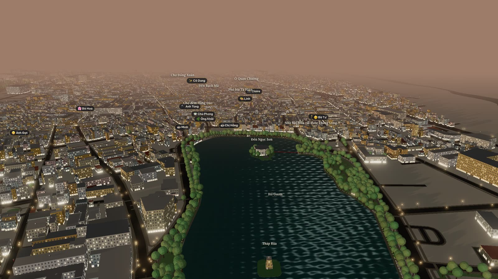
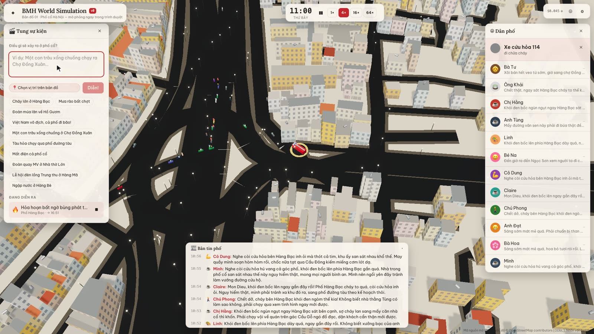
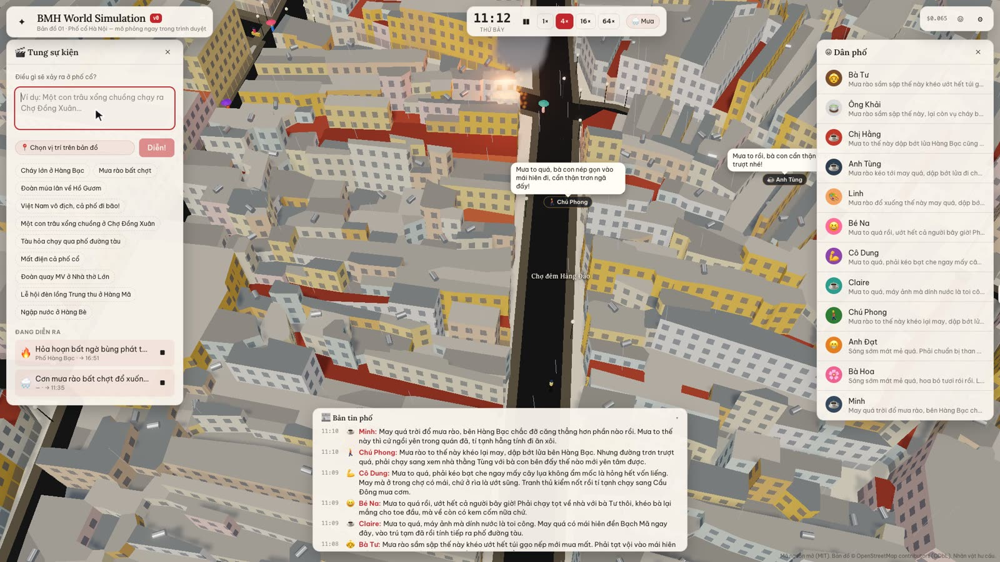
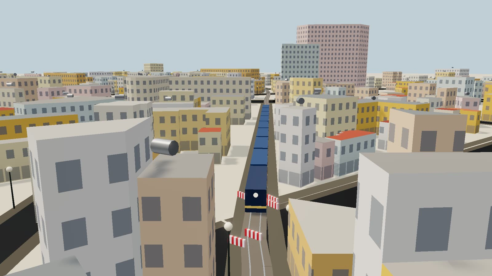
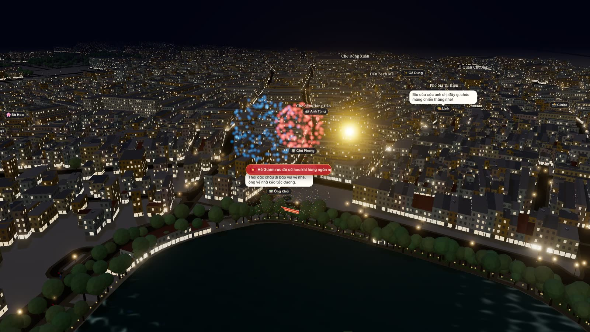

# BMH World Simulation v0

**Map 01 · Hà Nội Old Quarter.** The whole Old Quarter of Hà Nội, running in your browser: 11,000+ real buildings from OpenStreetMap, a few hundred pedestrians and motorbikes living out their day, and 12 residents with AI minds who plan, gossip and react to whatever happens. Type anything — *"a fire on Hàng Bạc"*, *"Vietnam wins the cup"*, *"a buffalo escapes into Đồng Xuân market"* — and the city performs it.

> 🇻🇳 Hướng dẫn tiếng Việt: [README.md](README.md)



This is an **open testbed for LLM agents living in real cities**. v0 is Hà Nội's Old Quarter; fork it, bake your own city, add your own people and events. No server, no account, MIT-licensed.

---

## Contents

1. [What's inside](#1-whats-inside)
2. [Run it in two minutes](#2-run-it-in-two-minutes)
3. [Add an AI key (or don't)](#3-add-an-ai-key-or-dont)
4. [Using it](#4-using-it)
5. [Event catalogue](#5-event-catalogue)
6. [The residents](#6-the-residents)
7. [The rhythm of the Old Quarter](#7-the-rhythm-of-the-old-quarter)
8. [Cost](#8-cost)
9. [How it works](#9-how-it-works)
10. [Fork it: bake your own city](#10-fork-it-bake-your-own-city)
11. [Add a resident](#11-add-a-resident)
12. [Add an event kind](#12-add-an-event-kind)
13. [Add an AI provider](#13-add-an-ai-provider)
14. [Recording video](#14-recording-video)
15. [Tests](#15-tests)
16. [Known limitations](#16-known-limitations)
17. [Ideas to contribute](#17-ideas-to-contribute)
18. [Licence and credits](#18-licence-and-credits)

---

## 1. What's inside

| | |
|---|---|
| 🏘️ **A real city** | 11,125 buildings, 1,526 street segments, Hoàn Kiếm Lake with its two islets, the red Thê Húc bridge, Turtle Tower, 1,239 trees and the railway, all baked from OpenStreetMap into one 1.7 MB file. |
| 🚶 **A crowd** | ~380 pedestrians and ~240 motorbikes. People walk the road edge (the pavements are full of parked bikes), bikes keep right, and everyone routes with A* over the real street graph. |
| 🧠 **12 AI residents** | Each has a bio, relationships, a daily plan and memories. They decide where to go and what to think, and stop to chat when they meet someone they know. |
| 🎬 **Type it, they act it** | A director model reads your sentence, picks one of 17 event kinds, a real place and props. The world performs it with prepared assets: fire, smoke, a fire engine, rain, fireworks, lanterns, a stage, barriers, a train… |
| 🕰️ **A real calendar** | Dawn exercise by the lake, noodle lunches, and on weekend evenings the lake walking street and the Hàng Đào night market. |
| 🌗 **Day and night** | A moving sun, lit windows after dark, street lamps, lake lights, rain and lightning. |
| 🔒 **No server** | Everything runs in the browser. Your AI key goes straight to the provider. Without a key it runs offline. |

<table>
<tr>
<td></td>
<td></td>
</tr>
<tr>
<td></td>
<td></td>
</tr>
</table>

---

## 2. Run it in two minutes

You need [Node.js](https://nodejs.org) 20.19 or newer.

```bash
git clone https://github.com/BMH-AI-Technologies/bmh-world-simulation-v0.git
cd bmh-world-simulation-v0
npm install
npm run dev
```

Open **http://localhost:3418**. Nothing else to configure: the map is pre-baked in `public/data/pho-co.json`, and without a key the residents use scripted lines.

For a static build you can put on any host (GitHub Pages, Netlify, Vercel, S3…):

```bash
npm run build      # → dist/: just HTML, JS, CSS and the map file
npm run preview
```

Recommended browsers: recent Chrome, Edge, Arc, Safari 17+ or Firefox on a machine with a GPU. It runs on weaker machines too, just at a lower frame rate.

---

## 3. Add an AI key (or don't)

Click **⚙** at the top right.

### Default: Vercel AI Gateway + Gemini 3.8 Flash

1. Go to [vercel.com](https://vercel.com) → **AI Gateway** → **API Keys** and create a key (`vck_…`).
2. Paste it into **API key**, keeping the provider set to **Vercel AI Gateway**.
3. Both residents and the director default to `google/gemini-3.8-flash`. You can pick any other Gateway model, for example `google/gemini-3.5-flash-lite` to save money.
4. Click **Save**. The "offline mode" banner disappears and the spend meter appears at the top right.

### Other providers

| Provider | Key | Notes |
|---|---|---|
| Vercel AI Gateway | `vck_…` | Default. One key for Gemini, Claude, GPT… |
| Google Gemini | AI Studio key | Calls the Gemini API directly. |
| OpenAI-compatible | depends | OpenAI, OpenRouter, DeepSeek, Groq, or **local Ollama / LM Studio** (set the Base URL, e.g. `http://localhost:11434/v1`, and leave the key empty). |
| Anthropic | `sk-ant-…` | Direct browser access. |
| Mock (offline) | none | Scripted lines, no network. |

### Where does my key go?

- **Only** from your browser straight to the provider you chose. There is no server of ours in between.
- With **"Remember key on this device"** ticked, it is stored in this browser's `localStorage` (key `bmh-world-sim:settings:v1`). Untick it and the key lives only for the current session.
- There is a **per-session spend cap** (default $2). When it is reached, residents fall back to scripted lines.

### No key?

Everything still works: the city, the crowd, events and props. The director uses keyword rules (Vietnamese with or without accents, and English), and each resident speaks from their own scripted lines. They just repeat themselves and don't really think.

---

## 4. Using it

### Camera

| Action | Mouse | Touch |
|---|---|---|
| Pan | left-drag | one finger |
| Rotate / tilt | right-drag | two-finger twist |
| Zoom | scroll | pinch |

### Time

- The clock sits in the middle of the top bar. The simulation starts at **05:30 on a Saturday**.
- At **1×**, one real second is 30 simulated seconds; a full day takes 48 minutes.
- **4× / 16× / 64×** fast-forward, **❚❚** pauses (the 4× button is hidden on phones).
- Chips beside the clock show **rain**, the **walking street** and the **night market**.

### Follow someone

- Click a name in the **☺ Residents** panel on the right, or click a person on the map.
- The camera flies over and **follows** them. Dragging the map stops following; click the name again to resume.
- For a resident, the panel shows their bio, current thought, what they're doing, **today's plan** (the current step highlighted) and recent **memories**.
- For a passer-by, it shows their name, role (local, tourist, street vendor, student) and errand.
- When residents speak, a speech bubble appears over them.

### Make something happen

1. Open **🎬 Make something happen** (the ✦ button at the top left if it's hidden).
2. Type what should happen, in Vietnamese (with or without accents) or English. Press **Enter** or click **Action!**
3. Or click one of the examples.
4. To choose the exact spot, click **📍 Pick a spot on the map**, then click the map.
5. If your sentence names a real street or landmark ("…on Hàng Bạc"), that place always wins.
6. **Happening now** lists running events: click one to fly there, **■** to stop it early.

Tip: stacking events is the fun part. Try *"a fire on Hàng Bạc"* then *"a sudden downpour"* and read what the residents say about both.

### Street news

The **📰 Street news** strip at the bottom logs everything: events, residents' thoughts, conversations, and the city calendar (walking street opens, night market sets up…). Click a resident's name in it to follow them.

---

## 5. Event catalogue

The director always maps your sentence onto one of these 17 kinds. Anything that fits none becomes a **Gathering**, where curious people come to look. Violent requests, or ones aimed at real people, are also turned into a harmless gathering.

| Kind | What you see | Crowd | Try |
|---|---|---|---|
| 🌧️ Rain | falling rain, wet streets, umbrellas, people sheltering | shelter | *a sudden downpour* |
| ⛈️ Storm | heavy rain, lightning, far fewer bikes | go home | *a thunderstorm rolls in* |
| 🔥 Fire | flames, smoke and firelight; a fire engine drives in from the map edge and firefighters hose it until it's out | people nearby flee, people further away watch | *a big fire on Hàng Bạc* |
| 🏮 Festival | lantern strings, a stage, sweeping beams, a banner, fireworks after dark; no vehicles | gather | *Mid-Autumn festival on Hàng Mã* |
| 🦁 Lion dance | a lion and drummers moving around the area | gather | *a lion dance at Hoàn Kiếm Lake* |
| 🎌 Parade | marchers with flags walking in a column; no vehicles | gather | *a parade on Đinh Tiên Hoàng* |
| 🇻🇳 Street celebration (đi bão) | hundreds of flag-waving motorbikes circling the lake, fireworks; the walking street gives way | celebrate | *Vietnam wins the cup!* |
| 🔌 Power cut | windows and street lamps go dark, phone torches come out | carry on | *power cut on Hàng Gai* |
| 🌊 Flood | rising water, bikes crawl, people wade | avoid | *flooding on Hàng Bè* |
| 🚧 Road closed | barriers and traffic police; bikes reroute | avoid | *road closed on Hàng Đào* |
| 🛵 Traffic jam | dozens more bikes inching along | carry on | *traffic jam on Hàng Ngang* |
| 🚂 Train | the train squeezes down train street (the AI director may add barriers) | come and watch, standing clear of the rails | *the train through train street* |
| 🐃 Loose animal | a buffalo, dog or chickens running around | gather | *a buffalo escapes into Đồng Xuân market* |
| 🎬 Film shoot | camera, lights, tents and actors | gather | *a music video shoot at the cathedral* |
| 🚑 Accident | two bikes down, an ambulance arrives, traffic police | gather | *a crash on Hàng Bạc* |
| 👥 Gathering | balloons, a curious crowd | gather | *free giveaway on Tạ Hiện* |
| 🌙 Curfew | everyone goes home, streets empty | go home | *curfew, everyone home* |

With an AI key, the director also chooses **duration**, **intensity**, **props** (barriers, lanterns, stage, tent, fireworks, flags, police, ambulance, fire engine, camera, balloons, smoke, fire, spotlights, banner, confetti), and writes a **news headline** and a short description. Residents nearby (or everyone, for quarter-wide events) are told and decide how to react.

---

## 6. The residents

All of them are fictional.

| Resident | Who | Lives on |
|---|---|---|
| **Bà Tư**, 71 | has sold sticky rice at the alley corner for 40 years; knows every child's name | Hàng Bè |
| **Ông Khải**, 76 | retired literature teacher: tai chi at dawn, xiangqi in the afternoon | Hàng Gai |
| **Chị Hằng**, 38 | runs an upstairs egg-coffee café over the lake, worried about the rent | Cầu Gỗ |
| **Anh Tùng**, 29 | third-generation silversmith, secretly opening an online shop | Hàng Bạc |
| **Linh**, 20 | art student who sketches the streets and waits tables on Tạ Hiện at night | Hàng Buồm |
| **Bé Na**, 10 | Bà Tư's granddaughter, loves lion dances and ice lollies | Hàng Bè |
| **Cô Dung**, 47 | fabric trader at Đồng Xuân market, counts faster than a calculator | Hàng Chiếu |
| **Claire**, 34 | French photographer hunting the perfect shot on train street | Mã Mây |
| **Chú Phong**, 52 | neighbourhood warden of Hàng Đào, always first on the scene | Hàng Đào |
| **Anh Đạt**, 33 | bún chả cook who sings while he grills | Hàng Mành |
| **Bà Hoa**, 63 | sells flowers from a bicycle around the lake; has known Ông Khải since school | Hàng Thiếc |
| **Minh**, 26 | remote developer who writes threads about the Old Quarter | Lương Văn Can |

How they work:

- **Plan** each morning: 4–7 timed stops, chosen only from real places near home.
- **Think** every 70–130 simulated minutes: a mood emoji, a thought, maybe something said out loud, and a decision to carry on, go somewhere, stay put or go home.
- **React** right away when something happens nearby.
- **Chat** when two of them are within 14 m (always if they know each other, sometimes if not), at most once every 4 hours per pair. Each then keeps a one-line memory of it.
- **Sleep** after 23:00 and wake from 04:30.

---

## 7. The rhythm of the Old Quarter

Passers-by don't use AI. They follow rules, but the rules follow the Old Quarter's real rhythm:

- **04:30–07:00**: older people exercise by the lake; breakfast stalls open.
- **Rush hours, 07:00–09:00 and 16:30–19:00**: the most motorbikes.
- **Noon**: lunch; afternoons: coffee, shopping, school's out.
- **Evening**: dinner and lake walks; tourists head to Tạ Hiện for bia hơi.
- **Friday–Sunday from 19:00**: the **Hoàn Kiếm walking street**; the roads around the lake close to vehicles.
- **Friday–Sunday 18:00–23:00**: the **Hàng Đào – Đồng Xuân night market**, with stalls and lights; no vehicles.
- When it rains, about three in ten people head home to shelter, and most of the rest open umbrellas; motorbike traffic thins.

---

## 8. Cost

Measured with `google/gemini-3.8-flash` through Vercel AI Gateway (October 2026):

- About **$0.0014–0.0016 per call**, 3–10 seconds each.
- A video recording session (68 calls: plans, reactions, chats, director) cost **$0.09**.
- A busy simulated day is a few hundred calls, so **a few tens of cents**.

To spend less: use a "lite" model for residents, set a low spend cap, or run a local model through Ollama (free).

The on-screen meter uses the price table in `src/llm/pricing.ts`, so treat it as an estimate.

---

## 9. How it works

```
OpenStreetMap ──fetch-osm──▶ data/*.json ──bake──▶ public/data/pho-co.json
                                                        │
                                   ┌────────────────────┴───────────────────┐
                                   ▼                                        ▼
                         World (src/world)                      View (src/render, three.js)
                   graph, places, name lookup                 city, people, props, light
                                   │                                        ▲
                                   ▼                                        │
                          Sim (src/sim) ── tick ~60×/s ─────────────────────┘
            clock · crowd · agents · events · effects · residents
                                   │
                                   ▼
                     MindRuntime (src/llm) — queue, budget, fallback
                     Gateway / Gemini / OpenAI-compatible / Anthropic / Mock
```

### Layout

| Path | Job |
|---|---|
| `scripts/fetch-osm.mjs` | downloads raw OSM data in tiles, retrying across Overpass mirrors |
| `scripts/bake-osm.mjs` | projects to metres around the map centre; normalises buildings, streets, water, trees and points of interest; keeps the largest connected street network |
| `src/world/world.ts` | street graph, spatial grid, accent-insensitive place lookup, landmarks |
| `src/sim/path.ts` | A* that respects closed and slowed streets |
| `src/sim/agent.ts` | one agent: follows a path, offsets to the road edge or lane, decides what to do on arrival |
| `src/sim/crowd.ts` | passers-by and bikes: who is out at what hour and where they go |
| `src/sim/events.ts` | the 17 event kinds, the director schema, the offline keyword director |
| `src/sim/effects.ts` | how each event is performed: who shows up, what the crowd does, which streets close or slow |
| `src/sim/residents.ts` | the 12 characters, prompts, and plan / react / chat schemas |
| `src/sim/sim.ts` | main loop, city calendar, residents' minds, news feed |
| `src/llm/` | providers, schema-checked JSON calls, queue, spend meter, mock |
| `src/render/city.ts` | buildings as one merged mesh with a lit-window shader, streets, lake, trees, lamps, rooftop steel water tanks, Turtle Tower, Thê Húc bridge |
| `src/render/people.ts` | instanced people and bikes, fire engine, lion, buffalo… |
| `src/render/props.ts` | per-event props, rain, night market, lake lights, flood water, the train |
| `src/render/scene.ts` | time-of-day lighting, bloom, labels, camera, picking, capture mode |
| `src/ui/` | the React interface |

### One frame

1. The clock advances. The calendar turns the walking street and night market on or off.
2. Events: finished ones end, running ones update (has the fire engine arrived, how much fire is left…).
3. Every so often, a crowd-reaction sweep for each event.
4. People and bikes: idle ones pick their next errand, moving ones keep going.
5. Residents: follow their plan, think now and then, chat when they meet.
6. Draw: time-of-day light, people, props, labels.

Simulated time is decoupled from on-screen motion: people walk about 3 m/s while the clock runs 30 simulated seconds per real second. Movement looks natural, and a day still passes quickly enough.

### How the AI is called

- Every call goes through `MindRuntime`: a priority queue (director > event reactions > chats > plans > idle thoughts) with at most 4 calls in flight.
- Every reply is validated with **zod**. If it's invalid, the error is sent back to the model once to fix. If it's still broken, or the provider fails, that call falls back to the mock, so the city never freezes.
- For Gemini 3.x on the Gateway the code sets `reasoning_effort: "low"`. By default the model "thinks" for 5–17 s and its hidden reasoning eats the token budget.
- Residents get their situation as text: time, weather, which street they're on, their plan, memories, acquaintances nearby, what's going on, and the list of places they may choose.

---

## 10. Fork it: bake your own city

Map projection, routing, the crowd, events and rendering work anywhere. A few pieces are written specifically for Hà Nội's Old Quarter; the table below lists them all so you know what to change.

### Step 1 — choose an area and download it

Pick a box roughly **1–2 km on a side**. Bigger areas overload the public Overpass servers and give the browser more to draw.

Set `BBOX` (south, west, north, east) in **both** files:

```js
// scripts/fetch-osm.mjs and scripts/bake-osm.mjs
const BBOX = { s: 10.7700, w: 106.6950, n: 10.7830, e: 106.7080 }; // e.g. District 1, Saigon
```

```bash
npm run fetch-osm   # → data/*.json (gitignored)
npm run bake        # → public/data/pho-co.json, and prints stats
```

To rename the map file, change the default path in `loadWorld()` in `src/world/world.ts`.

### Step 2 — change the Hà Nội-specific parts

| Where | Currently | What to do |
|---|---|---|
| `src/world/world.ts`, the `pick(...)` list | Old Quarter landmarks (Turtle Tower, Đồng Xuân market, Ô Quan Chưởng gate…) | swap in your landmarks, matching their exact OSM names |
| `src/world/world.ts`, lake section | finds water named `Hoàn Kiếm` to build the "Hồ Gươm" landmark and `lakeNodes` | point it at your central lake, square or park. Without one, lake walks are skipped, but **the street celebration needs a loop to ride**, so give it another route |
| `src/sim/sim.ts`, `lakeWays` and `marketWays` | lake walking street; Hàng Đào – Hàng Ngang – Đồng Xuân night market | rename the streets or drop the rules in `schedule()` |
| `src/sim/residents.ts`, `PROFILES` | 12 Hà Nội characters; `home`, `work` and daily stops are real street names | write new characters with your street names (see §11) |
| `src/sim/events.ts` | Vietnamese and English keywords; the director prompt mentions "Hà Nội's Old Quarter" | edit the prompt; add keywords for your language |
| `src/sim/effects.ts`, train | OSM railway and the `/đường tàu/` landmark | point it at your rail or tram line, or drop this event kind |
| `src/render/city.ts`, `props.ts` | lake-shore trees and lights (`/Hoàn Kiếm/`), Turtle Tower, Thê Húc bridge | swap or remove |
| `src/ui/i18n.ts` | tagline and example prompts | rewrite for your city |
| `src/sim/crowd.ts` | share of tourists and street vendors, rush hours | tune to how your city lives |

### Step 3 — check it

```bash
npm test
```

`tests/world.test.ts` checks for Hà Nội landmarks: change them to yours. The other tests work for any city.

Tips:

- Buildings without a level count get one guessed from footprint size, in the 2–5-storey tube-house style. For a high-rise city, adjust the `levels` logic in `bake-osm.mjs`.
- The projection is flat around the map centre, which is accurate enough for a few kilometres.
- If Overpass returns 429 or 504, re-run `npm run fetch-osm`; it tries other mirrors.

---

## 11. Add a resident

Add an entry to `PROFILES` in `src/sim/residents.ts`:

```ts
{
  key: "lan",                       // unique id
  name: "Cô Lan", age: 45, female: true,
  color: 0x2a9d8f,                  // shirt colour
  hat: 1,                           // 0 none, 1 conical hat, 2 cap
  job: { vi: "Bán nước chè", en: "Tea seller" },
  bio: { vi: "…", en: "Has sold tea on the Hàng Bông corner for 20 years and knows everyone's business." },
  home: "Hàng Bông",                // must be a real street or landmark on the map
  work: "Hàng Bông",
  knows: { tu: { vi: "bạn hàng", en: "fellow vendor" } },
  day: [["06:00", "Hàng Bông", { vi: "bày hàng", en: "set up" }], /* … */],   // offline schedule
  voice: { vi: ["Chè nóng đây!"], en: ["Hot tea here!"] },                   // offline lines
}
```

- `home` and `work` must resolve through `world.resolvePlace()`. If they don't, the resident appears at the lake.
- `knows` uses other residents' `key`s. Acquaintances always stop to chat.
- The model reads `bio` most closely. Specific details (job, habits, worries) make a livelier character.

---

## 12. Add an event kind

For example, a street performer:

1. **`src/sim/events.ts`**: add `"busker"` to `EVENT_KINDS` and a `CATALOG` entry (icon, Vietnamese and English names, a description for the director, radius, duration, crowd reaction, default props, keywords). Add it to `MATCH_ORDER`, ahead of more generic kinds.
2. **`src/sim/effects.ts`**: in `startEvent`, spawn actors (`sim.spawnActor`), close or slow streets (`ev.fx.ways`) and keep state in `ev.fx`. Update it each frame in `tickEvent`, and clean up in `endEvent`.
3. **`src/render/props.ts`**: add the visuals for `ev.kind === "busker"` in `build()`. Visuals only read `ev.fx`; they never change state.
4. **`src/render/people.ts`**: if the actor needs a new mesh (like the buffalo or the lion), add it to `makeSpecial`.
5. **Tests**: add a sentence to `tests/events.test.ts` and to the "performs every event kind" list in `tests/sim.test.ts`.

To add a **prop** any event can use, add its name to `PROPS` (the director will see it) and draw it in `props.ts`.

---

## 13. Add an AI provider

1. Write `src/llm/providers/<name>.ts` returning `{ id, complete(req) }`. Use `gemini.ts` or `anthropic.ts` as a model: send `system`, `prompt` and `schema` (if the provider supports it), and return `{ text, usage }`.
2. Add the `ProviderId` in `src/llm/types.ts`, a branch in `createProvider()` (`src/llm/index.ts`), default models and prices in `src/llm/pricing.ts`, and a display name in `PROVIDER_LABEL`.
3. The provider must allow direct browser calls (CORS). Otherwise the app stops being serverless.

Test against a real model:

```bash
AI_GATEWAY_API_KEY=vck_… npm run test:live
# another model:
AI_GATEWAY_API_KEY=vck_… SIM_MODEL=google/gemini-3.5-flash-lite npm run test:live
```

---

## 14. Recording video

The view can record smooth 30 fps video on any machine, even a slow one. In the browser console:

```js
const { sim, view } = window.bmhSim;
view.manual = true;          // stop the real-time loop
view.advance(1 / 30);        // move exactly one frame, then take a screenshot
sim.speed = 4;               // speed still applies in this mode
```

Because the world only moves when you call `advance()`, waiting for model replies never shows up as a stutter in the video.

For quick stills, run `npm run shoot` (needs the dev server running and Chrome). Scene options (`SCENES=…`) are in `scripts/shoot.mjs`.

---

## 15. Tests

```bash
npm test             # offline: map, routing, keyword director, every event kind, calendar, train, celebration
npm run typecheck
npm run test:live    # needs AI_GATEWAY_API_KEY: director, plan, reaction and chat against a real model
npm run shoot        # stills of a few scenes (needs `npm run dev` and Chrome)
```

---

## 16. Known limitations

- **People are tiny from far away.** They're already drawn 1.5× life size; follow someone to see them up close.
- **Offline mode repeats itself.** There are few scripted lines, so many residents say similar things. With an AI key it's a different city.
- **Residents only walk**; they can't ride motorbikes yet.
- **No saved state.** Reload and the city goes back to 05:30.
- **No crowd collision.** People can pass through each other in dense crowds.
- **Performance on low-end machines and older phones** isn't well measured yet. Phones get a smaller crowd automatically.
- **The offline director only matches keywords**, so it can misread unusual sentences. The AI director is far better.
- **Prices in `pricing.ts` may be stale.** Treat the spend meter as an estimate.
- The map ends in a flat plane: fog hides it at night, but it's visible from far away by day.

---

## 17. Ideas to contribute

- 🗺️ **Map 02**: your city — Saigon, Hội An, Đà Lạt, Huế, or anywhere.
- 💾 **Save and share scenarios**: export a sequence of events as a link that reopens the same scene.
- 🧠 **Long-term memory**: nightly memory summaries; relationships that change over time.
- 🛵 **Residents on motorbikes** and buses.
- 🗣️ **Voices** for the speech bubbles.
- 💻 **In-browser models** (WebGPU) to play free, without a key.
- 🧪 **Measured experiments**: "close Hàng Đào to vehicles all day — what happens to the neighbouring streets?", exported as CSV.
- 🎨 Nicer meshes for people, bikes and props; real tiled roofs instead of flat ones.

### How to contribute

1. Fork, branch, change.
2. `npm test` and `npm run typecheck` must pass.
3. Open a pull request describing what changed, with screenshots for anything visual.
4. New code should read like the code around it: strict TypeScript, no server, and no data sent anywhere except the AI provider the user chose.

---

## 18. Licence and credits

- Code: **MIT** — see [LICENSE](LICENSE).
- Map data: © **OpenStreetMap contributors**, under the [ODbL 1.0](https://www.openstreetmap.org/copyright). The attribution is always shown in the app and is embedded in the map file; keep it if you redistribute the baked map.
- All residents are **fictional**; any resemblance is coincidental.
- An open-source project by **BMH AI Technologies**.
